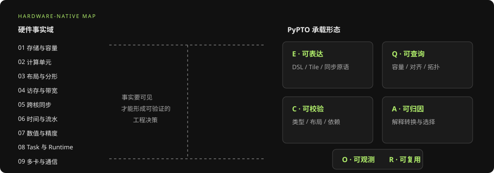
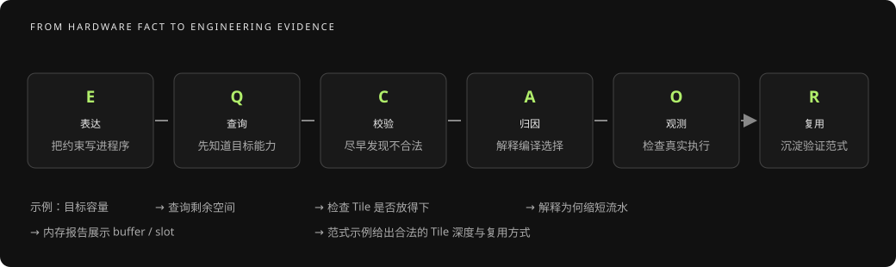
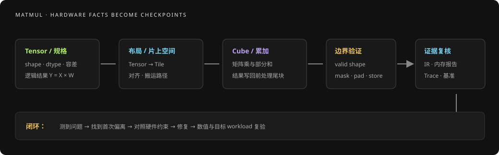
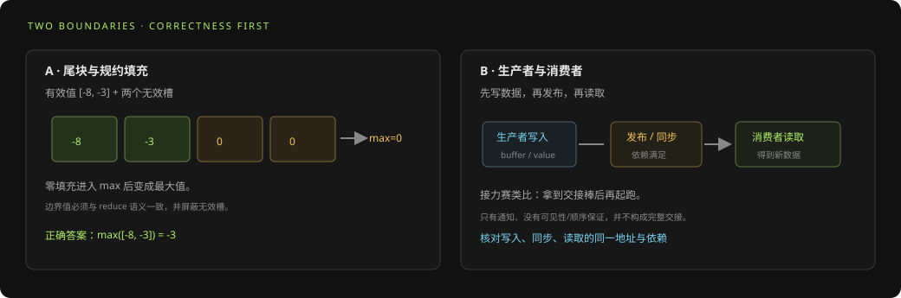

# Hardware-Native System 基础：让硬件事实进入编程模型

> FOUNDATION SERIES · 04 / 05  
> 面向 PyPTO 模型工程师、算子开发者与工具团队。本文把仓库中的 Hardware-Native 规划与事实域整理成入门地图；硬件数值、API 与诊断覆盖会随目标芯片和软件版本变化，使用时应回到对应版本的源码与文档复核。

## 摘要

Hardware-Native 不等于“把所有硬件细节都暴露给用户”。更实用的理解是：当一条硬件事实会影响程序正确性、可编译性或性能时，编程模型要让开发者能表达它、查询它、验证它，或在编译与运行结果中观察到它。抽象可以简化操作，但不能让关键约束无声消失。

本篇沿着两条线展开：第一条是“硬件有什么事实”，第二条是“PyPTO 用什么方式承载这些事实”。最后通过一个带尾块的矩阵计算与跨核分工案例，说明怎么把硬件知识转化成开发检查项。

## 1. 从一个问题理解 Hardware-Native

假设你写了 `C = A × B`。数学定义只说明结果是什么，却没有回答 A、B 怎样进入矩阵计算单元、输入布局是否满足分形约束、累加器在哪个空间创建、Cube 与 Vector 怎样协作，以及尾块要如何屏蔽。上述问题的答案由目标硬件、目标代际和编译实现共同决定。

Hardware-Native 的目标不是让每位算子作者手写每条设备指令，而是保证这些会裁决结果的事实有明确落点：需要时能够表达；写代码前能够查询；不合法时尽可能早地报出；优化后可以从 IR、报告或时间线看出编译器做了什么。

> **生活化理解：按地形设计一条城市道路。** 抽象像城市地图，让驾驶员不用关心每颗螺丝；硬件事实像道路宽度、桥梁承重与交通信号。如果地图把这些限制藏起来，路线可能“画得通”却无法通车。Hardware-Native 就是让影响通行的限制在合适位置可见、可检查。

### 三个判断问题

| 判断 | 要问的问题 | 缺失时的风险 |
| --- | --- | --- |
| 会裁决吗？ | 这条硬件事实会改变正确性、可编译性或性能吗？ | 只讲背景细节会分散注意力；没讲关键限制则可能产生错结果或慢程序 |
| 代码能推导吗？ | 开发者能从 DSL 与通用数学直接推出它吗？ | 推不出的限制若只藏在后端，用户只能靠试错 |
| 在哪里承载？ | 它应进入 API、检查、错误信息、报告、时间线还是范式示例？ | 没有承载形态就形成抽象泄漏 |

这组问题是内容组织方法，不是对任意芯片功能的完整定义。特别是“编译器当前会检查”与“我们希望编译器检查”要区分开来。

## 2. 两张地图：事实域与承载形态

### 2.1 九个硬件事实域

下面九域覆盖从单 Tile 到多卡运行的主要决策面。它们相互影响，不是九个互不相关的硬件模块。

| 事实域 | 入门问题 | 写程序时的例子 | 生活化记忆 |
| --- | --- | --- |
| 1. 存储层级与容量 | 数据当前在哪个空间？还能放多少？ | 从 DDR 载入 Vec/Mat，再为矩阵乘准备 Left/Right；累加结果使用 Acc | 仓库、货架和工作台各有容量与用途 |
| 2. 计算单元与分工 | 哪类计算由哪类执行单元完成？ | Cube 做矩阵乘，Vector 执行逐元素与向量工作；混合 Kernel 可能需要显式跨边界传值 | 不同工种使用不同工具，各自擅长不同任务 |
| 3. 布局与分形 | 逻辑 shape 与设备需要的存储布局是否相容？ | NZ/分形布局可能有静态 shape、秩和对齐前提 | 物品按规定方向和尺寸装进专用箱格 |
| 4. 访存粒度与带宽 | 一次读写的粒度与合并效率怎样？ | 小而不连续的 GM 访问可能降低有效带宽 | 一次运一整箱通常比反复跑去拿零件省路程 |
| 5. 跨核通道与同步 | 生产者何时发布数据，消费者何时读取？ | AIC/AIV 之间的 push/pop 或通知必须形成正确的先写后读顺序 | 交接单签收后，下一位才开始加工 |
| 6. 时间与流水 | 哪些动作能够重叠，缓冲区能存活多久？ | 多缓冲允许搬运与计算重叠，但需要足够容量和正确依赖 | 下一单备料时上一单可以烹饪，但不能拿错托盘 |
| 7. 数值与精度 | 数据格式、累加顺序和误差门槛是什么？ | 低精度输入、高精度累加和 cast 链会共同影响数值结果 | 量杯精度与称量方法会影响最后配方味道 |
| 8. 任务与运行时 | 静态 Kernel 如何成为动态 Task？ | 依赖、调度、派发间隙和设备占用都会影响端到端完成时间 | 菜谱是可复用流程，每张订单是一次实际派工 |
| 9. 多卡与通信 | 每个 rank 持有什么数据，何时交换或归约？ | collective、通信缓冲、rank 间同步和计算重叠共同决定系统行为 | 多家分店各做一部分，最后还要按规则汇总订单 |

这些名称来自仓库 Hardware-Native 内容规划。表格是学习索引，不代表某一版本已经为每域提供完整 API 或诊断。

### 2.2 六种承载形态

| 代号 | 承载形态 | 它回答什么 | 一个典型例子 |
| --- | --- | --- | --- |
| E | 可表达（Express） | 用户如何把约束写进程序？ | Tile、布局、MemorySpace、split 模式与显式同步原语 |
| Q | 可查询（Query） | 用户如何在编写或调参前获知目标能力？ | 查询目标容量、对齐要求、可用 Cluster 数或合法搬运路径 |
| C | 可校验（Check） | 错误能否在编译期或运行前发现？ | 类型/布局检查、资源诊断、越界或跨核语义检查 |
| A | 可归因（Attribute） | 结果变化由哪项硬件约束或编译决定？ | 解释布局改写、内存复用或流水未启用的原因 |
| O | 可观测（Observe） | 用户怎样看到真实执行情况？ | Pass 前后 IR、内存映射、Task 依赖、设备泳道与关键路径 |
| R | 可复用（Reuse） | 正确的硬件用法如何跨算子复用？ | 经验证的 matmul、混合 Kernel、流水和通信范式 |

> **六种形态的生活化记忆：** 菜谱写法（E）、查询厨房库存（Q）、食材规格检查（C）、解释为什么换锅/换路线（A）、摄像头和计时记录（O）、把验证过的做法存成标准配方（R）。一个编译器报告往往只覆盖其中一两类，不能据此推断其他形态也齐备。

同一条事实可能需要多种形态。例如容量约束既可以由 Q 查询，也可以由 C 检查；若编译器因容量不足降低流水深度，还需要 A 解释、O 显示，并通过 R 给出适用的替代范式。

## 3. 一次矩阵乘如何体现硬件原生思维

以 `C = A[M,K] × B[K,N]` 为例，先把注意力从单行 DSL 移到实际决定正确性的事实。

### 第一步：写清输入契约

先确定 M、N、K 的 shape 范围，dtype、张量布局、精度误差和尾块行为。如果 shape 动态，需明确哪些维度动态、哪些编译期已知；如果矩阵需要预打包布局，应说明生产端与消费端使用同一契约。这样算法工程师和算子开发者才有共同的正确性标准。

> **生活化理解：先确认家具尺寸和门框。** 沙发能不能进门，取决于宽高、转向空间和门框尺寸，不是只看“这是一张沙发”。同样，shape、layout、dtype、对齐和动态范围共同决定输入能否进入目标计算路径。

### 第二步：规划数据路径

硬件矩阵单元通常要求操作数落到相应的片上操作数空间，结果累积在累加空间。具体可用搬运路径按目标代际而异；不能仅凭“两个空间名字不同”就假设存在直接搬运，也不能假设所有后端使用同一条转换路径。

开发者应把每个阶段的逻辑 Tile、目标布局、目标 MemorySpace 与必要搬运写清楚，再通过编译产物确认后端实际生成了什么。源代码中的 `transpose_view`、`move` 或 `matmul` 名称都不足以单独证明真实搬运成本。

### 第三步：处理尾块与填充值

假设 K 维不是 Tile 大小的整数倍，最后一个 Tile 有效元素数小于物理容量。此时必须同时核对加载范围、计算有效范围与写回范围。若对部分有效 Tile 做最大值规约，使用 0 填充可能让全负数行错误地得到 0；填充值应符合规约语义，例如最大值规约需采用相应的最小值语义。仓库材料将此列为静默数值陷阱。

### 第四步：确定执行分工

矩阵计算与向量后处理可能由不同执行单元承担。显式 split/shard/gather 表达计算在哪一侧执行、值如何跨边界；这些 API 的具体合法组合与同步要求需按目标版本检查。用户不仅要证明“每个值被算出来”，还要证明它在消费者读取前已写入并正确发布。

### 第五步：观察编译与运行证据

把关键 IR 阶段、Pass 诊断、资源报告和运行时间线关联起来。如果编译器改写布局或插入数据搬运，先判断它是否满足目标后端约束，再用时间线确认它是否处于关键路径。编译器替你做了转换，不表示转换一定免费；转换出现也不表示一定是性能问题。

## 4. 案例：全负数的尾块为什么可能算出 0

设想每行做 `max`，Tile 的物理长度为 4，而尾部实际只剩 2 个元素。某行的有效值是 `[-8, -3]`。

1. 如果无效位置填成 0，物理 Tile 会近似为 `[-8, -3, 0, 0]`。
2. 对整个物理 Tile 求最大值，结果变为 0，而正确结果应为 -3。
3. 这不是算术公式写错，而是 padding 取值与有效区域契约不匹配。
4. 由于只有尾块且输入全负时触发，常规正数样例可能完全通过。

排查时依次记录原始 shape、尾 Tile 的 `valid_shape`、填充值、规约轴、有效区 mask、输出写回范围和首次偏离的中间值。再确认当前编译/验证工具是否真的覆盖了这项语义；若没有自动诊断，就把反例纳入正确性回归。

| 问题层 | 检查项 | 可接受的证据 |
| --- | --- | --- |
| 算法语义 | 全负、全正、混合符号和空/边界行的定义 | 参考实现和容差契约 |
| Tile 边界 | 物理容量与有效 shape 是否分开 | IR 或测试中可复核的有效区域 |
| 编译变换 | padding / mask / reduce 是否被保留或合法改写 | 相关阶段 IR diff |
| 运行结果 | 错误是否依赖特定行、shape 或 dtype | 最小可复现输入与中间值对照 |

## 5. 案例：混合 Kernel 中的跨核传值

当 Cube 生成部分结果而 Vector 消费它时，正确性依赖三个事实：生产者写入什么地址、值何时对消费者可见、消费者在什么条件下开始读取。

> **生活化理解：接力赛交棒。** 前一棒跑完并把接力棒交到手上，后一棒才能起跑。只发一个“可以开始”的通知、却没有保证数据已写好，就像队友还没拿到棒便提前冲出去。同步关注的是数据何时可见、依赖何时满足，而不仅是有没有一个信号操作。

一个可用的推理过程是：先确定数据在哪条执行 lane 产生；再确认对应 API 表达了 AIC/AIV 边界；随后追踪 buffer 地址、通知或依赖边；最后用 Task/设备 trace 或最小数值复现确认生产先于消费。对同步语义有歧义时，不把“单机偶尔通过”当作顺序保证。

仓库九域详解指出，某些 split 模式下可能存在编译器无法从局部语法推断的 lane-uniform 条件，以及写与通知之间的可见性要求。因而诊断器应区分：已经静态检查的结构、运行时证据支持的顺序，以及仍待复现实验验证的假设。

## 6. Hardware-Native 开发检查单

### 写代码之前

- 固定目标芯片代际、编译器/运行时版本和支持的模型 shape。
- 为每个关键事实注明来源、可变范围和适用对象，尤其区分通用规则与特定 target 属性。
- 写清输出语义、精度、布局、尾块行为以及跨核/跨 rank 的数据所有权。

**小例子：** 选一个新的目标芯片，就像换了一个厨房：灶台数量、锅具尺寸和传菜路线可能都不同。先核对 target 与软件版本，再复用旧设备上的 Tile 和流水参数；旧参数可以作为起点，但不能当作新目标的容量事实。

### 编译时

- 确认硬件能力是通过 API 查询、静态检查还是文档约束表达；不要把“未报错”理解为“已完整验证”。
- 保存前后 IR、Pass 诊断和资源信息；遇到自动改写，先解释其输入、输出与前置条件。
- 对内存、流水、同步和布局同时关注正确性和代价。

### 运行与验收时

- 用包含边界、特殊数值、并发和目标 workload 的用例验证正确性。
- 通过 trace / 泳道确认设备实际上做了什么，区分等待、搬运、计算和 Host 派发。
- 把结论绑定到版本、设备、输入、计时口径和基线；不要把某代硬件的数字泛化为通用规律。

## 7. 容易混淆的概念

| 容易混淆 | 应如何区分 |
| --- | --- |
| Hardware-Native = 暴露所有硬件细节 | Hardware-Native 强调关键事实有承载方式；抽象仍可简化不影响决策的细节 |
| 编译通过 = 硬件语义全都正确 | 通过只覆盖实际执行的检查；未检查的数值、同步和工作负载行为仍需测试 |
| Pass 自动改写 = 一定更快 | 改写首先满足合法性或生成目标表示，性能效果要测量 |
| 某芯片数值 = 所有代际常量 | 容量、访问粒度、布局与执行拓扑可能随 target 改变 |
| 观察到某个操作 = 根因已确定 | IR/trace 是证据，需要通过最小实验判断因果关系 |

## 8. 术语速查

| 术语 | 简要解释 |
| --- | --- |
| Hardware-Native | 让影响正确性或性能的硬件事实在编程体验中可表达、可查询、可检查或可观察 |
| MemorySpace | Tile 或缓冲所处的逻辑/硬件映射存储空间 |
| 分形布局 | 为目标矩阵计算或存储组织提供的设备数据布局形式 |
| AIC / AIV | 仓库资料中的矩阵类 / 向量类执行资源术语 |
| valid shape | 物理 Tile 中实际属于逻辑输入的数据范围 |
| 关键路径 | 决定一次运行何时完成的依赖链 |

## 参考资料

- [PyPTO 的 Hardware-Native 内容：维度体系与内容清单](../PyPTO_Hardware-Native内容维度与清单_20261019.md)
- [PyPTO Hardware-Native：九个昇腾硬件事实域详解](../PyPTO_Hardware-Native九域详解_20261019.md)
- [Hardware-Native 反馈设计：两个案例](../Hardware-Native反馈设计_两个案例_20261020.md)
- [PTO3 源码、调度与硬件执行概念术语手册](../PTO3_源码_调度_硬件执行概念术语手册.md)
- [PyPTO 算子开发基础白皮书](./算子开发基础_从数学规格到可验证Kernel.md)
