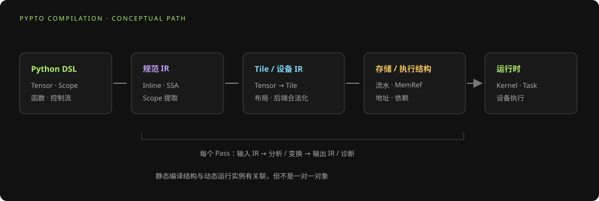
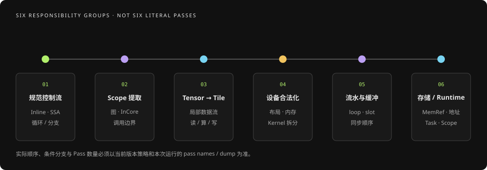
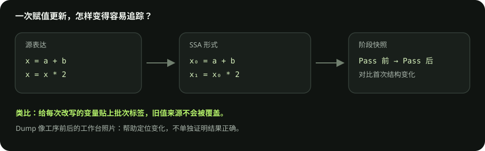
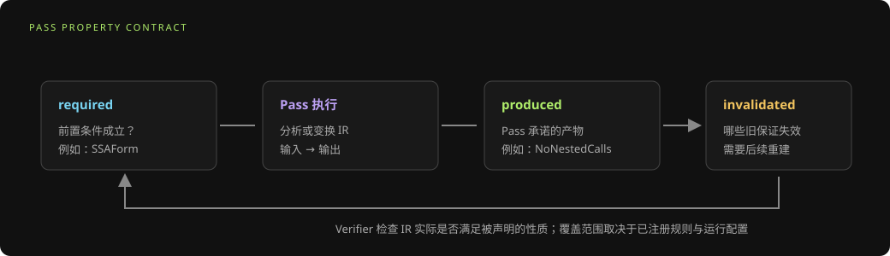
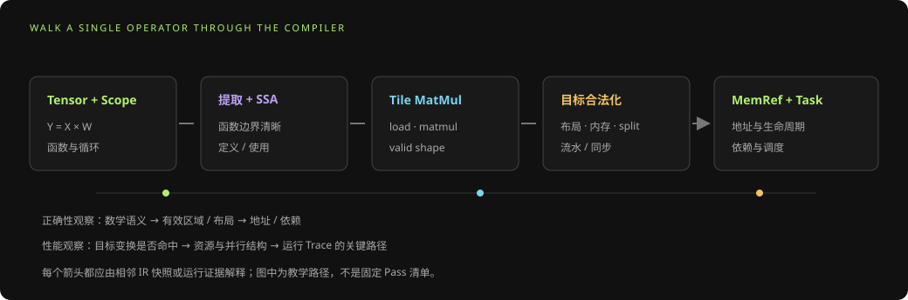

# PyPTO Pass 流水线详解：从 Tensor 到设备任务

> FOUNDATION SERIES · 05 / 05  
> 面向 PyPTO 用户与编译器/工具开发者。本文结合仓库 `repo/pypto` 镜像中的 PassManager 实现与配套中文 Pass 文档解释阶段职责；具体顺序会随代码版本变化，应以当前使用的源码、策略和运行配置为准。

## 摘要

PyPTO Pass 流水线是一系列有序的 IR 变换：每一步接收一个程序表示，按自身规则分析或生成新表示，再交给后续步骤。流水线把高层 Tensor/Scope 表达逐渐转换为 Tile 运算、设备 Kernel、内存引用与运行时任务关系。

阅读 Pass 的关键不是背诵名称，而是能回答四个问题：输入 IR 是什么、Pass 解决什么问题、输出新增或改变了什么、用哪项证据验证判断。本文先建立阶段地图，再介绍属性系统和插桩，最后沿着矩阵乘案例定位变换与常见失败。

## 1. Pass、Pipeline 与 PassManager 是什么

| 名称 | 含义 | 便于理解的类比 |
| --- | --- | --- |
| IR | 编译器内部表示，描述程序结构与运算 | 便于机器变换和检查的程序蓝图 |
| Pass | 对 Program 执行一类分析或变换的步骤 | 一道加工/检查工序 |
| PassPipeline | 按顺序组合并执行多个 Pass 的对象 | 有明确工序顺序的生产线 |
| PassManager | Python 高层管理器，构造策略并提供运行入口 | 选择产品线与参数的调度台 |
| PassContext | 本次运行的插桩和验证上下文 | 随生产线运行的记录与质检配置 |
| IRProperty | IR 结构或语义性质的标记 | “已满足某项前置条件”的记录 |

仓库 `repo/pypto` 的 `OptimizationStrategy` 在所读镜像中只定义 `Default`；不要把另一个 PTO 镜像里的策略名照搬成 PyPTO API。`PassDumpLevel` 提供 NONE、CONCISE、EXPLICIT 三个转储详细级别，调用入口和默认值要以对应版本的 `pass_manager.py` 为准。

## 2. 流水线阶段地图

从入门视角，可以把流水线归成六段。它们是帮助理解的职责分组，不是额外的真实 Pass，也不代表每次运行都只有这六个阶段。

| 阶段 | 目标 | 代表 Pass（以镜像文档为例） | 看什么变化 |
| --- | --- | --- | --- |
| A. 规范与控制流 | 消除内联调用、展开循环、整理控制流并建立 SSA | `InlineFunctions`、`UnrollLoops`、`CtrlFlowTransform`、`ConvertToSSA`、`Simplify` | 函数体、循环/分支结构、变量定义与使用 |
| B. Scope 拆分与分层 | 将图、层级、InCore、Cluster 等作用域变成可分别处理的函数/结构 | `OutlineHierarchyScopes`、`OutlineGraphScopes`、`OutlineIncoreScopes`、`OutlineClusterScopes` | 新函数边界与调用关系 |
| C. Tensor 到 Tile | 将张量表达下沉为设备侧 Tile 数据流，并处理复合操作 | `ConvertTensorToTileOps`、`OptimizeOrchTensors`、`LowerCompositeOps` | Tensor 运算与 Tile load/compute/store 的关系 |
| D. 设备合法化与映射 | 处理维度、布局、分形、后端约束、内存空间和混合 Kernel | `FlattenTileNdTo2D`、`BlockNzTensorViews`、`AutoTileMatmulL0`、`InferTileMemorySpace`、`ResolveBackendOpLayouts`、`ExpandMixedKernel` | shape/layout、搬运、AIC/AIV Kernel 结构 |
| E. 流水与缓冲 | 物化流水循环、跨核 skew、缓冲槽和 I/O 顺序 | `SkewCrossCorePipeline`、`LowerPipelineToSlots`、`LowerPipelineLoops`、`CanonicalizeIOOrder` | 循环迭代、buffer slots、同步配对与读写顺序 |
| F. 存储和 Runtime 准备 | 建立 MemRef、复用并分配地址，推导调用方向/Task 依赖并物化运行时结构 | `InitMemRef`、`MaterializeSemanticAliases`、`MemoryReuse`、`AllocateMemoryAddr`、`DeriveCallDirections`、`AutoDeriveTaskDependencies`、`MaterializeRuntimeScopes` | 生命周期、地址范围、Task 依赖、Runtime Scope |

一个真实版本可能增删或重排上述步骤，也可能在特定 Pass 中根据 backend 或输入结构跳过一部分工作。要对照自己的 `get_pass_names()` 或实际 dump，而不是把表格当作所有运行的固定合同。

## 3. 逐段理解：每一类 Pass 在解决什么

### A. 规范与控制流

高层 Python 程序包含函数调用、循环、分支和赋值。后续编译规则希望看到可预测的形式，因此流水线会内联某些函数、展开可处理循环、改写控制流、转换 SSA 并做简化。SSA 让每个变量定义关系清楚，便于数据流分析；它本身并不意味着程序已映射到硬件。

可以把 SSA 想成给每次改写的变量贴上不同批次标签：普通代码里的 `x = x + 1` 会覆盖旧的 x；SSA 会写成 `x₁ = x₀ + 1`，读代码时能直接看出新值来自哪个旧值。分支合流时还会显式标出“值从哪条路来”，方便后续分析。

小例子：`x = a + b; x = x * 2` 可表示为 `x₀ = a + b; x₁ = x₀ * 2`。这只是在整理变量定义关系，数学结果仍是 `(a+b)*2`；如果后续 dump 里出现 `x₀`、`x₁`，不代表多算了一遍。

### B. Scope 拆分与分层

Scope 描述模型/设备编程里的执行区域。将不同层级的 Scope 提取出来，后续 Pass 才能分别分析 orchestration、图调度、InCore 运算和 Cluster 行为。提取后应通过函数调用关系理解程序；一个源码 Scope 不保证与一个设备 Kernel 或一次运行时 Task 一一对应。

生活化地看，Scope 像一张整店订单被拆成前台、厨房和配送三张工单：每张工单有自己的输入输出，但完成一张工单不等于只发生一次设备执行。检查提取结果时，先看工单（函数）之间怎样交接，再看某个 Scope 是否符合预期。

### C. Tensor 到 Tile

Tensor 表达完整逻辑数据及高层算子，Tile 表达设备局部处理的数据块。下沉阶段需要明确加载、局部操作、布局与写回。复合算子可继续分解为基础表达；其后再把 ND tile 规范成后端要求的形状。

例如长度为 10 的向量，在一次只能处理 4 个元素的局部工作台上，可以分成 `4 + 4 + 2` 三盘。最后一盘只有两个有效元素，余下的位置需要 mask 或其他合法的尾块处理。Tile 的逻辑 shape、有效 shape 和存储布局回答的是不同问题，不能只看“盘子大小”。

### D. 设备合法化与映射

这个阶段将逻辑算子匹配到目标后端布局与能力。矩阵乘可能需要 L0 tile 形态；NZ/MX scale 视图可能被分块或实体化；Tile 的 MemorySpace 需要推断；混合 Kernel 可能拆为 AIC、AIV 与协调结构。看到自动插入的 reshape、搬运或 helper 函数，不应马上视为错误或开销，应先查看输入输出 IR 和目标后端约束。

这像把同一批货装进不同型号的货车：货物本身没变，包装和摆放要满足车辆尺寸与装载规则。有些“view”只是换一种看法，有些变换会真的搬动或转换数据；需要用前后 IR 和设备目标来判断。

### E. 流水与缓冲

流水的目标是使加载、计算和存储有机会重叠。跨核流水可能需要 skew；循环可能被转换成 slot 化的多缓冲结构，或展开成更显式的迭代和同步。是否采用特定变换取决于内存规划器、buffer 数量和目标硬件约束。生成更多 slot 也会增加容量占用，不是免费优化。

可以想成厨房有两个托盘：厨师在烤第一盘时，助手准备第二盘；第一盘出炉后托盘交换。只有当两盘的准备、使用、交接顺序清楚时才能并行，否则可能拿到尚未完成的食材。流水图里要同时看 slot、同步和每轮读写，而不是仅凭“有双缓冲”就判断正确或更快。

### F. 存储和 Runtime 准备

Tile 值最终关联到 MemRef 和地址区间。语义上必须共用的 buffer 与“因生命周期互不重叠而可以共用”的 buffer 是两种不同关系。完成内存初始化、别名处理和地址分配后，流水线还会解析函数参数方向、调用依赖、通信结构和 Runtime Scope，为运行时生成任务图。

内存复用像会议室排班：A 会议结束后，B 才能使用同一间房；如果两场时间重叠，就不能复用。编译器判断的是值的读写生命周期，Runtime 任务图还要保证生产者先完成、消费者后读取。地址相同不必然意味着语义别名，任务先后也不能只靠源码行顺序猜测。

## 4. Pass 属性：把前后置条件变成显式合同

Pass 可以声明三类 `PassProperties`：

| 声明 | 问题 | 示例 |
| --- | --- | --- |
| required | 开始变换前 IR 必须满足什么？ | `FlattenCallExpr` 需要 SSA 形式 |
| produced | 变换完成后 Pass 保证什么？ | `ConvertToSSA` 产生 `SSAForm` |
| invalidated | 变换后哪些旧保证不再可靠？ | 某些重写会改变语句结构，因此需重新建立结构属性 |

属性声明有助于发现错误的 Pass 排序和前置条件缺失。它不是对完整程序语义的形式化证明；属性能否被核实，还取决于对应 PropertyVerifier 是否注册、验证模式是否开启，以及当前 IR 是否覆盖该检查范围。

把它当作工序交接单：下一道工序要求“食材已经洗净”（required），当前工序承诺“切成规定大小”（produced），而某些重排操作可能让旧的摆盘记录失效（invalidated）。交接单让流程更容易检查，但不能替代成品试吃，也就是数值正确性验证。

仓库文档将 `VerifySSA`、`TypeCheck` 说明为验证器而不是 IR 变换 Pass。阅读 pass names 时应把“改变程序的步骤”和“检查程序是否满足某性质的规则”分开。

## 5. 观测 Pass：把变换过程变成可调试证据

### 5.1 逐 Pass IR Dump

简洁 IR dump 适合做相邻阶段对比；更详细的 dump 可暴露显式布局、分布式视图或别名信息（能力需核对镜像版本）。建议在最小复现上记录 Pass 名称与其输入/输出，而不是只截取最终 IR。若一轮生成大量文件，先缩小程序和 dump 详细程度，避免重要差异被噪声淹没。

仓库镜像中 `PassManager.run_passes` 支持 Pass dump 配置；直接运行 PassPipeline 时也可通过 `PassContext` 与 callback instrument 在前/后回调中记录数据。API 使用方式以 [PassManager 中文文档](../../repo/pypto/docs/zh/dev/passes/00-pass_manager.md) 为准。

把 dump 想成每道工序前后拍一张工作台照片。两张照片之间的第一次明显差异，能缩小排查范围；但照片只记录结构，不会自动告诉你变化是否正确。排查时记录同一轮运行的 Pass 名称、输入条件和前后快照，避免把不同编译配置的照片混在一起。

### 5.2 验证插桩

`VerificationInstrument` 可在 Pass 前检查所需属性、Pass 后检查其声明产出的属性，或按配置做前后验证。自动验证等级和覆盖范围由运行配置决定。一次“验证成功”只表示已执行的 verifier 对该 IR 谓词通过，不等于数值正确、无竞态或设备性能达标。

### 5.3 报告与追踪

内存报告帮助理解地址、生命周期和空间使用；执行 Trace/泳道帮助判断运行时 Task、等待和设备事件。编译 dump 解释“程序被变成什么结构”，运行时 trace 解释“设备实际何时执行”。两者通过源码映射、函数/Kernel 身份与 Run 信息关联，TaskId 不适合脱离运行上下文作跨轮次身份。

## 6. 案例：从 Tensor MatMul 追踪到设备准备

设 `Y = X × W`，X、W 为逻辑 Tensor，输出 Y 通过一个 InCore 区域计算。下面是概念路径，不是某次运行的固定 dump：

取一个手算得出的简单例子：`X=[[1,2],[3,4]]`、`W=[[5,6],[7,8]]`，则 `Y=[[19,22],[43,50]]`。例如左上角是 `1×5 + 2×7 = 19`。这个小矩阵便于核对数值；实际设备 Tile 的切分、布局和流水还要根据目标和真实 dump 确认。

1. **前端规范化**：检查函数、参数和控制流；循环/分支被改写成后端更容易分析的结构，变量进入 SSA。
2. **Scope 提取**：InCore 区域被拆成设备计算函数，编排函数保留输入输出连接。
3. **Tensor 降为 Tile**：MatMul 输入由完整 Tensor 变成有 shape、布局和有效区域的 Tile 操作，读写关系显式化。
4. **后端合法化**：矩阵 Tile 被调整为目标可接受的维度/布局；需要时插入 view、reshape、cast 或 memory-space 变换。
5. **执行结构生成**：InCore 运算可能拆出矩阵与向量 Kernel；流水循环和跨核同步转为可生成的结构。
6. **分配和任务建图**：Tile 绑定 MemRef，缓冲区按生命周期复用并分配地址；调用方向与依赖边为 Runtime 所用。

对每一阶段提出一个可验证问题：

| 检查边界 | 关键问题 | 对应证据 |
| --- | --- | --- |
| Scope 提取前后 | 运算是否落在预期 InCore 函数？输入输出签名是否稳定？ | 调用图和函数 IR |
| Tensor → Tile | load/store 覆盖了哪些逻辑索引？尾块有效区是什么？ | Tile shape、valid shape、mask 与 IO |
| 布局合法化 | 为什么布局或内存空间发生变化？目标要求是什么？ | Pass 前后 IR、backend 与诊断信息 |
| 流水/拆分 | 产生哪些 Kernel、buffer slot 和同步关系？ | Kernel 映射、循环 IR 与依赖边 |
| 地址分配 | 哪些值复用 MemRef？生命周期是否允许？ | 内存报告、地址区间及读写生命周期 |
| Runtime 建图 | 一个入口被实例化成哪些 Task？谁等待谁？ | Task 图、Run 标识与执行 Trace |

## 7. 诊断案例：结果第一次出错在哪一个边界

设一个算子在尾部输入上出现数值偏差。最有效的路径不是猜一个“可疑 Pass”，而是找到同一程序、同一输入下首次可观察的偏离边界：

1. 固定代码、target、软件配置、输入 shape/dtype 和复现条件。
2. 建立参考输出与首次偏差的中间 Tensor/Tile。
3. 对比相关相邻 Pass dump，定位有效区域、布局、mask、计算或存储首次改变的位置。
4. 查看偏差边界是否有对应属性/verifier；若没有，明确它属于未覆盖条件，不把通过自动验证当作正确性的证明。
5. 把失败缩小成最小复现，修改后重跑同一正确性门槛，再单独做性能评估。

“首次偏离的 Pass”是定位线索，不自动等于根因。Pass 可能合法地重新组织表达，真正问题也可能来自源语义、目标能力约束、别名生命周期、运行时依赖或错误的测试参考。

类比排查一份外卖少了一道菜：先核对订单，再看厨房工单、打包清单和配送记录，找出它第一次从“有”变成“没有”的交接点。编译问题同理：从正确的 Tensor 参考值出发，沿关键 IR 边界比较，找到首次不同处后再检查该 Pass 的规则与输入条件，避免只凭最后看到的错误结果猜根因。

## 8. 排查 Pass 问题的五类信号

| 信号 | 优先检查 | 避免的误判 |
| --- | --- | --- |
| 某阶段报类型/结构错误 | 最早失败 Pass、输入 IR、required property、scope 边界 | 只看最后一条堆栈而忽视首发错误 |
| 某 Pass 后 IR 大幅膨胀 | 循环展开条件、内联、Tile 分块、dump 是否完整 | 文件更大不等于设备代码一定更慢 |
| 编译成功但数值错误 | valid shape、padding、布局解释、buffer alias、依赖 | 只查“声明过的属性”而忽略未检查的语义 |
| 预期优化没发生 | 策略、target、输入特征、Pass 是否启用/命中分支 | 从源码中存在 Pass 推断本次一定运行了它 |
| 性能变化但 IR 看似相同 | Runtime dispatch、Task 依赖、数据准备、设备等待 | 只比较静态 IR 或只看 Kernel 平均时长 |

## 9. 建议的 Pass 调试工作流

### 先获取实际执行清单

- 从当前版本的 `PassManager` 获取策略与 pass names；确认 compile/run 配置没有切换策略或添加插桩。
- 保留版本与 target 信息，确认 dump 来自同一次编译。
- 区分源码已有的 Pass、策略注册的 Pass、条件命中而实际执行的 Pass。

### 再做最小相邻对比

- 先用 concise dump 找到第一个有意义的结构差异，再针对相关 Pass 提高 dump 详细程度。
- diff 关注函数边界、关键 OP、shape/layout、memory space、MemRef/地址、循环和依赖关系。
- 将实际 IR 与该 Pass 文档中的前置条件、产生性质和限制对照。

### 最后做独立验证

- 运行适用的结构 verifier 和数值 reference；分别报告它们的覆盖范围。
- 对性能问题重新建立未污染的基线，确认设备 trace 上的变化与端到端指标一致。
- 把已证事实、仍待验证假设和未覆盖路径分别记录。

## 10. 术语速查

| 术语 | 简要解释 |
| --- | --- |
| Lowering | 将高层表示逐步转换成约束更具体的低层表示 |
| SSA | 静态单赋值形式；每个变量定义对应唯一版本 |
| Outline | 将特定作用域提取成单独函数或程序单元 |
| Legalization | 把表达调整为目标后端可以接受的形状、类型或布局 |
| MemRef | Tile/数据值关联的存储引用及地址/范围信息 |
| Pass dump | 某一 Pass 执行前后 IR 的诊断快照 |
| PropertyVerifier | 检查 IR 是否满足特定结构或性质的规则 |
| PassContext | 为流水线运行提供插桩和验证设置的上下文 |

## 参考资料

- [PyPTO PassManager 中文文档](../../repo/pypto/docs/zh/dev/passes/00-pass_manager.md)
- [PyPTO PassManager 源码镜像](../../repo/pypto/python/pypto/ir/pass_manager.py)
- [PTO Pass Pipeline 文档（对照）](../../repo/pto/docs/zh-cn/dev/passes/00-pass_manager.md)
- [PyPTO 编译 Pass 问题典型案例](../PyPTO_编译Pass问题典型案例.md)
- [Hardware-Native 基础白皮书](./Hardware-Native基础_让硬件事实进入编程模型.md)
