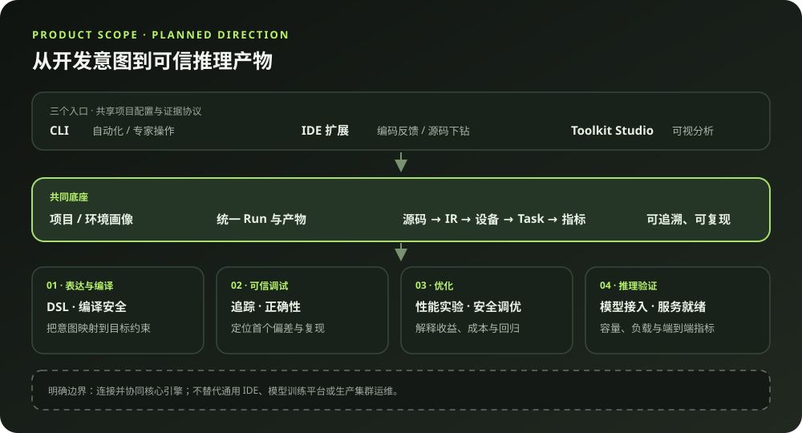
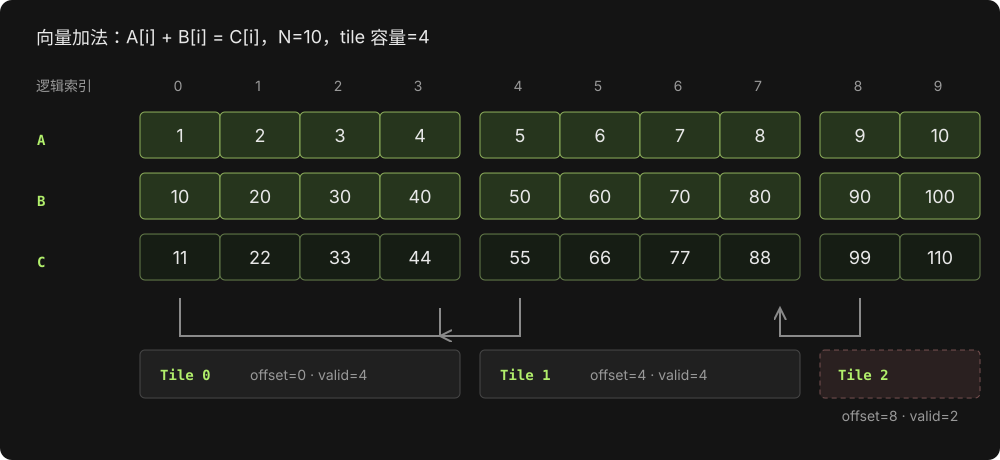
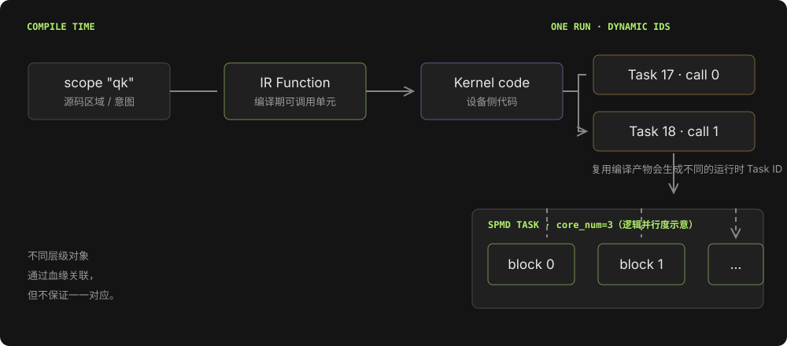
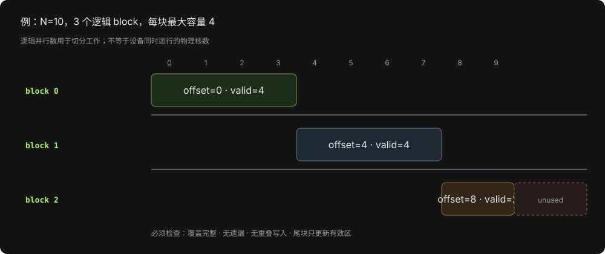
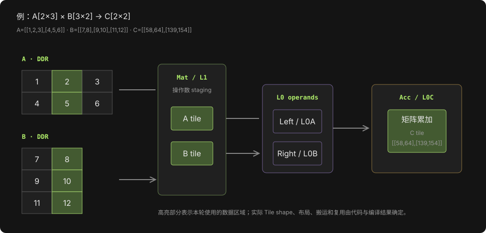
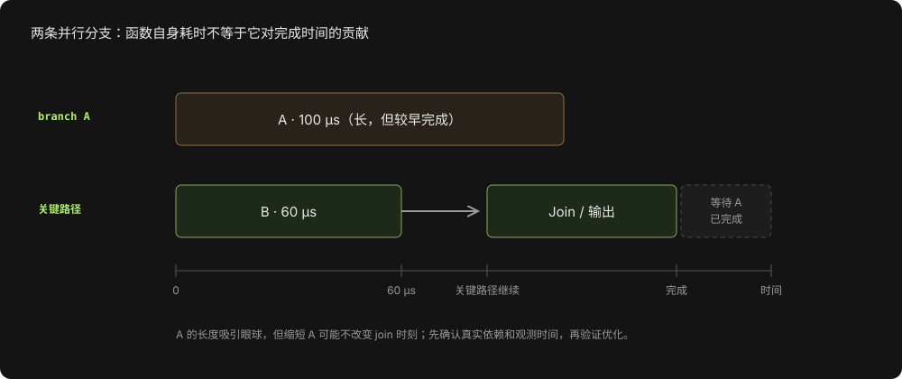
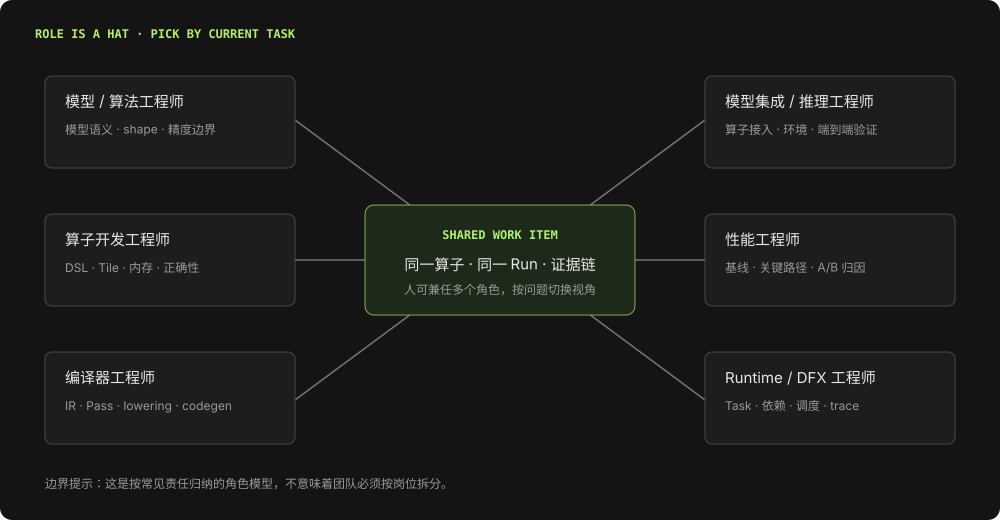
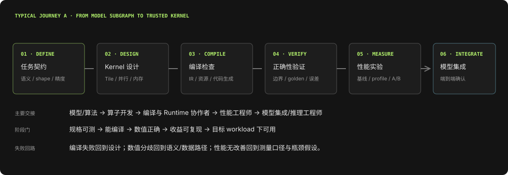
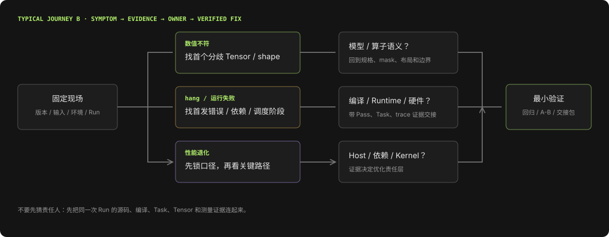

# PyPTO 基础：从 Python DSL 到设备执行

> 面向读者：初次接触 PyPTO/PTO 的模型工程师、算子开发者与工具团队。本文建立概念地图，不替代目标版本的 API 文档。

## 摘要

PyPTO 将 Python 作为算子与任务编排的表达入口，并通过编译流程把高层计算表达逐步变成适配设备的代码。理解它需要区分三件事：**源码表达的计算意图、编译器生成的函数与 kernel、运行时实际调度的任务和设备执行实例**。这些对象存在血缘关系，但并非一一对应。掌握这条链路后，开发者才能把编译诊断、运行时 trace 与源码联系起来。

## 1. PyPTO 解决什么问题

面向 AI 加速器编写高性能算子，既要表达数学计算，也要安排数据切分、片上存储、数据搬运、计算核映射和同步。只写张量级公式通常不足以说明数据如何进入硬件可用的内存、如何分块、由哪些执行资源处理。

PyPTO 提供 Python 侧的编程表达与编译基础设施；PTO 指向更贴近设备的算子/指令表达生态。具体项目中，PyPTO、PTO、后端编译器、运行时与硬件的职责边界会随版本和配置而异，不能仅凭名称推断功能已可用。

> **案例：向量加法为什么不只是一个公式？**
>
> 数学上，`C[i] = A[i] + B[i]` 很简单。开发者还要决定如何把 A、B 的分片读入片上内存、每个分片覆盖哪些 i、计算在哪类资源上执行，以及结果何时写回 C。PyPTO/PTO 的价值在于让这些计算和执行意图进入可编译、可检查的表达，而不只描述最终公式。

具体来说，如果 `A=[1,2,...,10]`，`B=[10,20,...,100]`，输出应是 `C=[11,22,...,110]`。在下文中，我们会沿着这组数字追踪：哪些值被装进 Tile、尾块有多少有效元素、逻辑分片如何覆盖索引，以及怎样判断一个性能变化是否真正影响完成时间。

> **生活化理解：菜谱与后厨。** 数学公式像“把两份食材对应相加”的菜谱；Tile/内存/分片则像决定一次拿多少食材、放在哪张案台、由谁处理以及何时交给下一位厨师。只给菜名能说明想做什么，还不足以安排后厨如何安全高效地完成。

### PyPTO 3.0 的产品建设范围

前面的 PyPTO 概念说明“程序如何表达和执行”；PyPTO 3.0 Toolkit 的产品规划则进一步回答“开发者需要怎样的完整工作台”。现有规划将其定位为面向 NPU 模型与算子开发者的**意图驱动、证据贯通、默认安全**的平台：从表达计算意图开始，连接编译、设备执行、正确性检查、性能优化，再延伸到模型推理和服务验证。



可以把它想成一个有完整工单与质检记录的设备开发车间：开发者带来“我要让这个模型/算子在目标设备上正确、稳定、够快”的任务；Toolkit 组织环境、编译和实验流程，并把每次判断关联到可复查的证据。它连接已有专业引擎，不意味着把编译器、运行时和硬件全部重新造一遍。

| 建设范围 | 要帮助用户完成什么 | 与本组白皮书的关系 |
| --- | --- | --- |
| 项目与环境底座 | 记录项目、软件/硬件能力、配置和 Run 身份，让结果可复现 | 为所有章节提供起点与上下文 |
| DSL 编写与编译安全 | 表达 shape、layout、并行、依赖和内存意图；及时发现目标约束与危险结构 | PyPTO 基础、Hardware-Native、Pass 流水线 |
| 追踪、调试与正确性 | 关联源码、IR、生成代码、Task 和数据结果，定位首次异常并保存复现证据 | Pass 流水线、算子开发 |
| 性能解释与优化 | 把算子、内存、同步、运行时和推理指标放在可比较的实验中分析 | 模型推理、Hardware-Native、算子开发 |
| 模型推理与服务验证 | 检查模型接入和算子覆盖，运行请求/负载，验证容量与端到端指标 | 模型推理，并连接到算子和设备执行 |

规划描述的三个使用入口是 CLI、IDE 扩展和可视化 Toolkit Studio；它们应共享项目配置与证据协议，而不是变成三套互不一致的工具。产品依赖并协同 `pypto`、PTOAS、`pto-isa`、runtime、算子库和 serving 等组件，具体职责和版本组合需要按目标环境确认。

**范围边界也很重要：** Toolkit 聚焦从模型/算子意图到可验证、可优化、可部署推理产物的开发闭环；规划明确不以通用 IDE、通用模型训练平台或生产集群运维平台为目标。首版 MVP 也不承诺无边界的 AI 自动改代码、通用自动算子生成或大规模 autotune 平台。

> **阅读提示：** 以上是产品规划中的目标能力与范围摘要，不是当前版本功能清单或交付承诺。阶段路线、MVP 条目和详细边界以[《PyPTO 3.0 Toolkit 产品功能规划》](../PyPTO3.0_Toolkit_产品功能规划.md)为准；建设必要性与价值论证见[《PyPTO 3.0 建设必要性与核心价值分析》](../PyPTO3.0_建设必要性与核心价值分析.md)。

## 2. 从 Tensor 到 Tile

- **Tensor** 通常代表较大的逻辑数据对象，常驻片外全局内存（如 DDR/GM）。
- **Tile** 是一次局部计算或搬运使用的数据块，可具有 shape、dtype、布局、有效区域和内存空间等属性。
- **Tile 操作**表达局部数据流，例如 load、move、matmul、reduce 与 store。

典型路径可以概括为：

```text
输入 Tensor → load 到片上空间 → 必要时 move/转换布局
             → Tile 计算 → 写回输出 Tensor
```

Tile 的逻辑 shape 与物理缓冲区 shape 可以不同。尾块常以较大的物理块配合较小的 `valid_shape` 表达；开发者必须保证无效区域不会污染有效结果。

### 案例：长度 10 的向量按 4 个元素分块

设 `A`、`B` 的长度都是 10，每个 Tile 的物理容量为 4。前两块分别覆盖 `[0,4)`、`[4,8)`，最后一块从 8 开始，物理容量仍是 4，但只含 2 个有效元素：

| Tile | 起始偏移 | 物理 shape | 有效 shape | 有效索引 |
|---|---:|---:|---:|---|
| 0 | 0 | 4 | 4 | 0–3 |
| 1 | 4 | 4 | 4 | 4–7 |
| 2 | 8 | 4 | 2 | 8–9 |

最后一个 Tile 的剩余物理位置不能被当成真实输入；写回时也只能让有效区域更新输出。这个例子说明 `shape` 与 `valid_shape` 表达不同事实，边界处理是算子正确性的一部分。



逐块算一遍：Tile 0 读取 `A[0:4]=[1,2,3,4]` 和 `B[0:4]=[10,20,30,40]`，得到 `[11,22,33,44]`；Tile 1 得到 `[55,66,77,88]`；Tile 2 只读取两个真实元素，得到 `[99,110]`。如果最后一块错误地把物理容量 4 当成有效长度，可能越界读到无关值，也可能把临时缓冲区残留写回。排查这类问题时，分别核对**输入读取范围、计算 mask、输出写回范围**，三者都应匹配有效长度 2。

> **生活化理解：整箱货物与分拣托盘。** Tensor 像仓库里的一整箱货，Tile 像工人一次放到托盘上的几件。托盘标准大小可以固定，但最后一个托盘可能留空；空格不是货物，不能被计数或发货。这对应 `valid_shape` 与物理 Tile shape 的区别。

## 3. 源码、编译与执行：三条线

```text
源码意图：scope / SPMD / Tile 操作
    ↓ parser、优化与 lowering
编译产物：IR Function / AIC、AIV 或混合 kernel
    ↓ runtime 提交与依赖解析
运行对象：Task / logical block / 设备执行事件
```

重要区分：

| 对象 | 所在阶段 | 含义 | 常见误解 |
|---|---|---|---|
| scope | 源码/IR | 组织计算或表达执行层级的区域 | 一个 scope 必然是一个 kernel |
| Function | IR | 编译流程中的可调用单元 | 每个 Function 都有独立运行时 Task |
| kernel | 后端产物 | 可由设备执行的代码单元 | 一个 kernel 只对应一次执行 |
| Task | 一次运行 | 运行时依赖图中的动态工作单元 | Task ID 可跨运行比较 |
| logical block | SPMD 展开 | 一份逻辑并行执行实例 | 固定绑定某个物理核 |

一个 InCore 区域可能被拆为多个 kernel；一个 kernel 也可在循环、重复调用或 SPMD 下产生多个 Task/block。名称提示（如 `name_hint`）适合建立源码与诊断产物的关联，但不是运行时唯一 ID。

### 案例：一次编译，多次调用

设一个编译入口调用同一个算子两次：第一次处理 `A、B`，第二次处理 `D、E`。编译后可以复用同一份 kernel 代码；运行时两次提交仍是两个动态工作实例，具有各自的依赖、输入和 TaskId。下次运行时 TaskId 还会重新产生，因此应按源码位置、函数映射和 run 标识追溯，而不要把 `TaskId=7` 当成永久身份。

另一个边界情况是混合计算：一个源码计算区域可能需要 AIC 与 AIV 协作，后端据操作构成拆成多个 kernel/调度单元。此时“源码一个区域”仍不能直接推出“设备只发射一个 kernel”。



这个图用 `scope "qk"` 举例，不表示固定编译结果。可把调试中的关联键理解为：源码区域/名称提示 → 编译后函数或 kernel 映射 → 本次 Run 中的 Task/执行事件。假设同一调用点在循环中执行 3 次，可能出现多个动态 task；下一次 Run 又会产生新的动态 ID。对比运行时应使用 Run 标识、源码映射和稳定的函数身份，不能只拿 TaskId 作跨轮次比较。

> **生活化理解：菜谱、烤箱程序和每张订单。** Scope 像一段菜谱，编译后的 Kernel 像可以重复使用的烤箱程序；每张订单是一次运行时 Task。一个程序可以被许多订单重复调用，所以程序编号不能直接当成订单编号。同理，编译对象与动态 Task 有关联，但不能简单一一对应。

## 4. 并行与执行层级

SPMD 表示同一逻辑程序由多个逻辑分片执行。通常需要通过 block 索引或其派生偏移让各分片处理不同数据。`core_num` 一类参数表达逻辑并行规模，不应直接等同于实际同时占用的物理核数；资源限制、调度和工作量会影响实际执行波次。

源码中的执行层级表达的是意图。最终映射到 AIC（矩阵/Cube 类计算）、AIV（向量类计算）或混合执行，需要经过编译与后端处理。遇到混合 kernel 时，计算区可能展开为协作的多个设备侧单元。

### 案例：10 个元素由 3 个逻辑分片处理

若按固定 `chunk=4` 把 10 个元素切成 3 个逻辑 block，可这样理解：

```text
block 0 → [0, 4)  4 个有效元素
block 1 → [4, 8)  4 个有效元素
block 2 → [8, 10) 2 个有效元素
```



一个常见的通用索引推导是 `start = block_idx × chunk`、`end = min(start + chunk, N)`。取 `chunk=4` 时，三个区间两两不重叠，合起来刚好覆盖 `[0,10)`。对于每个元素，只在 `i < end` 的有效范围内加载和写回。实际 PyPTO 程序如何读取 block 索引、表达 mask 和选择 `core_num`，应查看目标版本的 API 示例；上式是算法层伪代码，不是可直接运行的 PyPTO 代码。

这里有两个容易漏掉的判断：第一，分片数不是物理核数，若设备同时可运行的资源少于 3，block 可能分波；第二，平均切分不总是最优，工作量不均或每块开销过大时，应结合设备拓扑、任务粒度和关键路径测量调整。

> **生活化理解：把 10 份快递分给 3 位分拣员。** 逻辑 block 是任务分组，不是工人的工号。分成 3 组不代表一定同时有 3 个物理工位可用；如果只有 2 个工位，就需要先做两组、再处理剩下一组。分组大小也要考虑每份包裹的工作量，而不只追求数量相同。

## 5. 片上内存与数据流

常见内存空间包括 DDR、Vec/UB、Mat/L1、Left/L0A、Right/L0B 与 Acc/L0C。粗略的数据路径是：

```text
DDR → Vec 或 Mat → Left / Right → Acc → 后续搬运或写回
```

具体可用路径受操作类型、布局和后端约束影响。`tile.move` 可能改变内存空间或布局；某些视图操作只改变元数据，但若硬件不支持该视图，编译器可能将其变为真实搬运。需要从编译后 IR/代码和性能 trace 核实，而不能只看 Python 源码。

内存是否可复用还取决于 buffer 生命周期、别名和依赖关系。地址复用本身不等于错误；但若生命周期或同步描述错误，可能引入覆盖、竞态或精度异常。

> **生活化理解：厨房仓库、案台和传菜口。** DDR 像大仓库，Vec/Mat 等片上空间像厨房里不同用途的货架，Tile 像正在案台上加工的食材，`move` 像把食材从一个工作区搬到另一个工作区。货架之间未必都有直达通道；案台空出来后可以给下一道菜复用，但上一道菜还没用完就腾位置会造成“串菜”。实际通路和复用合法性需检查后端 IR 与生命周期。

### 案例：矩阵乘法中的“视图”和“搬运”

计算 `C = A[M,K] × B[K,N]` 时，A 与 B 的 tile 可能先从 DDR 进入 Mat/L1，再分别准备为 matmul 需要的 Left/L0A 与 Right/L0B，累加结果位于 Acc/L0C。切片、转置视图有时只改变元数据；若后端指令不能直接消费该布局，编译流程可能需要生成实际的数据搬运或重排。因而不能仅凭源代码中写了 `transpose_view` 就断定“没有拷贝”，要检查对应编译阶段与目标代码。



用小矩阵手算结果：

```text
A = [[1, 2, 3],      B = [[ 7,  8],      C = A × B
     [4, 5, 6]]           [ 9, 10],          = [[ 58,  64],
                          [11, 12]]             [139, 154]]
```

例如 `C[0,0] = 1×7 + 2×9 + 3×11 = 58`。硬件执行时可将 A 的行片段送入左操作数空间、B 的列片段送入右操作数空间，在累加器中累计 K 维的乘加，最后写出 C tile。图中的空间是典型概念路径，具体插入哪些搬运、用何种布局、tile 能否驻留，都以编译产物和目标后端约束为准。

如果想判断一次 `transpose_view` 是否造成真实搬运，建议对比变换前后的 IR：查看是否新增 `move`/`extract` 一类操作、目标内存空间是否变化、缓冲区字节数是否增加；再用时间线判断新增动作是否位于关键路径。仅仅看源码 API 名称无法得出搬运成本。

## 6. 编译流程的作用

概念上，编译器会执行解析/构图、IR 变换、内存空间推导、布局处理、kernel 拆分、流水与同步 lowering、内存分配及目标代码生成等工作。实际 Pass 名称和次序以目标版本为准。

编译结果不是“源代码的机械翻译”：它可能插入搬运、调整布局、展开循环或拆分执行区域。因此，诊断问题时要对比关键 Pass 前后的 IR，并将变化与报错、资源使用和运行结果对应起来。

### 案例：源代码没写 `move`，编译产物里为什么出现搬运？

假设一个生产者生成 Vec 空间的 Tile，而后续矩阵乘法要求左输入位于 Left/L0A。高层表达只写了生产和 matmul，内存空间推导或后端布局处理可能补出 Vec → Mat → Left 的转换。它可能是满足后端约束所需的动作，也可能成为性能热点；需要结合 Pass 输出、搬运量和时间线判断，不能把“自动插入”直接判为编译错误。

> **生活化理解：转运站按货物规格重新装箱。** 发件人给了货，下一条传送带只接受特定尺寸的箱子，分拣线就可能自动转运或换箱。这个动作可能是路线合法所必需，也可能额外耗时。检查依据应是具体 Pass 前后 IR、搬运量与关键路径，而不是只看源码里有没有写 `move`。

## 7. 调试与性能分析的证据链

建议按以下路径收集证据：

1. 固定代码版本、设备、软件栈、shape、dtype 与输入。
2. 先确认编译成功和数值正确，再测量性能。
3. 通过源码名称或映射文件定位函数与任务实例。
4. 查看依赖、时间线、关键路径与核内指标，区分计算、数据等待、资源等待和 Host/调度开销。
5. 每次只改变一个主要假设，并保留原始运行产物。

函数平均耗时、某个编译 warning 或单次 profiling 都不能独立证明端到端瓶颈。只有处于关键路径上的变化才直接影响该次运行的 makespan；对吞吐的影响还需在目标并发与服务负载下验证。

### 案例：函数表里最慢的函数，为什么不是第一优化目标？

某函数平均耗时 100 微秒，但它与主流程并行、且先于其他分支完成；另一个函数只耗时 60 微秒，却位于最终结果的关键依赖链上。缩短前者可能改善设备总工作量，却不一定缩短当前 run 的完成时间。下图把时间和依赖关系画成示意；数字只用于说明推理方式，不是实测数据。



实际分析时，先确定最终完成的任务及其前驱，再沿依赖链回溯；静态依赖路径说明结构下界，运行时路径还包含资源等待、派发间隙等因素。比较改动前后的干净 benchmark；若目标是吞吐，还要在目标并发下重新测量。

### 案例：Core 空闲不一定意味着 kernel 算得慢

时间线上出现设备核空闲，而后继任务尚未开始，可能是它还在等上游数据、依赖未满足，或 Host/Runtime 没及时提交；这与“任务已运行但核内计算效率低”是不同问题。先看 `dispatch → start`、前驱完成时间和关键路径阻塞类型，再决定优化算子本身还是任务图/提交过程。

> **生活化理解：十字路口的车队。** 一辆车发动机功率很强，不代表整队更早到达；它可能在等前车、等红灯或等调度放行。设备核空闲时，先确认任务是在算、在等数据，还是尚未派发，再决定优化 Kernel、依赖图或提交流程。

## 8. 新手检查清单

- 规格是否覆盖 shape、dtype、布局、边界与数值容差？
- Tile 的物理 shape、有效 shape 和访存范围是否一致？
- 目标内存空间和搬运路径是否满足操作与后端约束？
- SPMD 分片是否使用 block 身份正确划分工作？
- 依赖是否表达真实读写关系，是否存在不必要串行？
- 编译、正确性、资源门禁与性能测试是否使用同一组输入条件？
- 是否保存版本、配置、基线与诊断产物以便复现？

## 9. PyPTO 用户分类：按当前作业选择视角

PyPTO 工作横跨模型语义、Tile/Kernel、编译、Runtime 和性能测量。下面的分类归纳自仓库中的产品规划与开发者洞察，适合用来决定从哪一层开始看；它不是固定组织架构，也不代表每个项目都有六个独立岗位。一个人可以同时承担多个角色，应按当前任务切换视角。



| 用户类别 | 当前最关心的问题 | 常看对象与证据 | 本白皮书的阅读入口 |
|---|---|---|---|
| **模型 / 算法工程师** | 算子实现是否保留模型数学语义、边界条件和精度要求？ | 模型子图、参考实现、shape/dtype、关键中间 Tensor、精度门槛 | 第 1–3、8 章 |
| **算子开发工程师** | 怎样把公式映射成可编译、正确且高效的 PyPTO Kernel？ | DSL/scope、Tile、valid shape、MemorySpace、SPMD、编译产物和测试 | 第 2–6、8 章 |
| **模型集成 / 推理工程师** | 单个 Kernel 能否正确接入模型，并在目标 workload 下跑通？ | 算子覆盖、模型配置、运行环境、端到端输出、请求形状与缓存状态 | 第 1、3、7–8 章 |
| **性能工程师** | 用户感受到的慢发生在哪一层，改动是否真实改善目标指标？ | 测量契约、Serving/Host/Device 分项、依赖图、Swimlane、关键路径、A/B | 第 7、8 章 |
| **编译器工程师** | 哪个 IR 变换或后端约束改变了程序结构、内存或指令？ | Pass 前后 IR、Function/Kernel 映射、布局、代码生成、编译日志 | 第 3、5–7 章 |
| **Runtime / DFX 工程师** | Task 为什么没开始、挂起或未按预期并行？ | Task/TaskId、依赖、ready/dispatch/start/finish、scheduler 和设备 trace | 第 3、4、7 章 |

这些类别是**工作视角**，不是用户能力等级。新手或技术负责人可以从端到端旅程开始，再按问题下钻；只有当证据指出责任层后，才需要进入 IR、Runtime 或硬件细节。

## 10. 典型用户旅程

### 旅程 A：从模型子图到首个可信 Kernel

一名模型/算法工程师发现目标模型中的某个子图需要 PyPTO 实现；算子开发者将其做成 Kernel，再由编译、性能和模型集成角色协作完成验收。



| 阶段 | 用户此时要回答的问题 | 主要动作与产物 | 交接 / 通过条件 |
|---|---|---|---|
| **1. 定义任务** | 数学语义、目标 shape/dtype、支持边界和误差容限是什么？ | 模型/算法工程师给出公式、参考实现、代表性输入与精度要求 | 形成可执行的 `OperatorSpec`；未知条件显式记录 |
| **2. 设计 Kernel** | 怎样切 Tile、分配执行工作、选择内存路径？ | 算子开发者把公式映射为 Tile 操作、SPMD 分片、数据搬运和依赖 | 形成第一版实现；确认边界 Tile 和读写范围 |
| **3. 编译与检查** | 高层意图实际变成什么 IR、Kernel 和内存操作？ | 编译器/算子开发者查看诊断与关键 Pass，确认布局、资源约束、拆分和插入搬运 | 编译成功，关键转换可解释；否则带最早失败阶段回到设计 |
| **4. 正确性验证** | 普通 shape、尾块和特殊输入是否满足参考结果？ | 算子开发者与模型/算法工程师执行 golden/reference 对比，定位首个异常中间量 | 数值门槛通过，支持范围与未覆盖范围清楚 |
| **5. 性能测量** | 哪个目标指标变了，变化是否来自这次改动？ | 性能工程师冻结环境与计时口径，建立基线并做成对实验 | 有可复现 Run、离散度和瓶颈归因；无收益时回到假设而非盲目加参数 |
| **6. 模型集成** | Kernel 放进完整模型后输出和目标 workload 是否仍正确？ | 模型集成/推理工程师做模型级对齐与代表性请求验证 | 端到端质量、延迟/吞吐、资源边界均满足目标；交付可追溯基线 |

这条旅程有回路，不是编译后一路向前：编译失败回到实现/约束；数值不符回到数学语义、Tile 边界或依赖；性能不符先检查测量可比性与关键路径；单算子通过但模型输出分歧时，再向上检查调用、布局、权重与模型集成契约。

### 旅程 B：从异常现象到定位、修复与交接

这条旅程适用于“结果错了”“任务挂住了”或“性能退化了”。先固定同一次运行的代码版本、环境、输入和 Run，再按症状选择证据链，而不是先假设问题属于哪个团队。



| 症状入口 | 优先查看的证据 | 先问的问题 | 常见协作方向 |
|---|---|---|---|
| **数值错误或尾部异常** | 参考结果、首个分歧 Tensor、shape/valid shape、mask、写回范围 | 哪个中间值第一次偏离？错误是否只出现在尾块或特定 dtype？ | 模型/算法工程师确认语义；算子开发者检查 Tile；必要时请编译器/Runtime 协助核查变换或生命周期 |
| **编译失败或生成结构意外** | 最早失败的 Pass、输入/输出 IR、Function/Kernel 映射、资源诊断 | 是用户表达超出支持边界，还是某次转换/后端约束不满足？ | 算子开发者与编译器工程师根据 IR 和最小复现交接 |
| **Hang、超时或任务未启动** | 首发错误、Task 依赖、dispatch/start/finish 阶段、scheduler/设备 trace | 是依赖未满足、资源等待、提交间隙，还是设备侧执行异常？ | Runtime/DFX 工程师与算子开发者基于 Task 和 trace 协作 |
| **性能退化或指标不稳定** | workload manifest、干净基线、时间线、关键路径、Host/Device 分项 | A/B 是否同口径？变慢的是计算、等待、数据准备还是服务排队？ | 性能工程师定界瓶颈，再与算子、编译器、Runtime 或推理服务团队对接 |

交接时至少附上：**问题现象与目标、代码/软件/硬件版本、shape/dtype/输入、复现命令或 Run ID、最小失败样例、关键日志/IR/trace、已经验证和排除的假设、期待接手方回答的问题**。这样接手者可以复核同一证据，而不必重建整个上下文。

## 11. 案例串联：从一个异常 Tile 到可验证结论

假设长度为 10 的向量加法在尾部数据上偶发错误。可以沿前文概念逐步排查：

1. **回到规格**：确认最后两个元素都应参与结果，给定 `atol/rtol` 与输入值。
2. **检查 Tile 切分**：确认末块起点为 8、有效长度为 2；不能把物理容量 4 误当成有效长度 4。
3. **检查执行分片**：确认各 block 覆盖 `[0,4)`、`[4,8)`、`[8,10)`，既无遗漏也无重叠写入。
4. **检查编译与内存**：对比关键 IR，确认搬运和写回区域保留有效长度；核查末块临时缓冲区是否被过早复用。
5. **做最小复现**：固定输入和环境，先验证数值问题是否稳定重现，再逐项缩小差异。
6. **性能问题另开证据链**：修复后使用未开启额外 profiling 的 benchmark 建立基线；再从任务时间线与关键路径判断后续优化方向。

这是通用诊断示例，不指向某个已知 PyPTO 缺陷。它展示了如何把规格、Tile、SPMD、编译产物与运行证据串成同一次调查。

## 12. 术语速查

| 术语 | 简明解释 |
|---|---|
| IR | 编译器内部表示，用于表达和变换程序结构 |
| Tile | 面向局部计算的数据块 |
| InCore | 面向设备核心执行的计算区域表达，具体语义以版本文档为准 |
| SPMD | 单程序、多逻辑数据分片并行执行模式 |
| AIC / AIV | 矩阵类 / 向量类设备计算资源名称 |
| Task / TaskId | 一次运行中的动态工作对象 / 其标识 |
| MemorySpace | Tile 所在的逻辑或硬件映射内存空间 |
| lowering | 将较高层语义逐步转换为更接近目标执行形式的编译过程 |

## 参考资料

- [PTO3 源码、调度与硬件执行概念术语手册](../PTO3_源码_调度_硬件执行概念术语手册.md)
- [PTO3 写算子过程中的硬件内存感知与配置](../../Insight/PTO3写算子过程中的硬件内存感知与配置.md)
- [PyPTO 性能调优方法论：从证据采集到可复现收益](../../Insight/PyPTO性能调优方法论_基于Toolkit与案例.md)
- [PyPTO 3.0 Toolkit 产品功能规划](../PyPTO3.0_Toolkit_产品功能规划.md)（用户角色与目标作业）
- [人、Agent 与 Toolkit 协作模式：算子开发流程](../人-Agent-Toolkit协作模式_算子开发流程.md)（开发阶段与交接方式）
- [PyPTO 开发者真实流程与体验机会分析](../../Insight/pypto-lib_开发者真实流程与体验机会分析_20260904.md)（Issue 归纳的开发阶段与常见阻塞）
- [PyPTO 中文训练深度解析报告](../../Insight/pypto_training_中文深度解析报告_20260915.md)（训练相关内容用于对照架构层次，不视为已交付能力）

