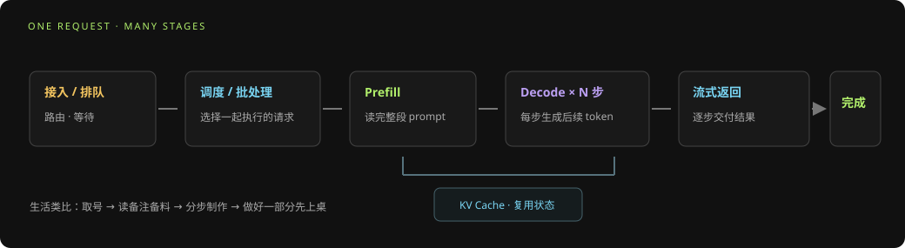
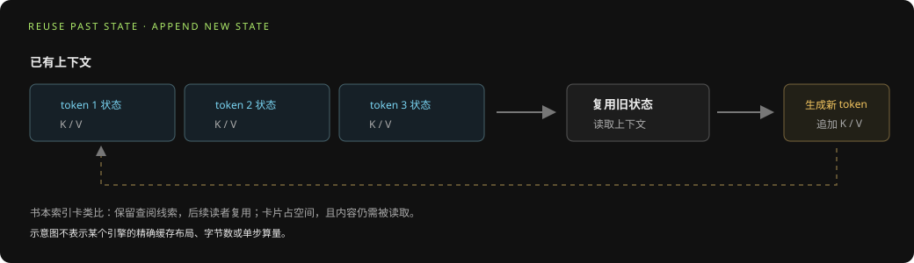
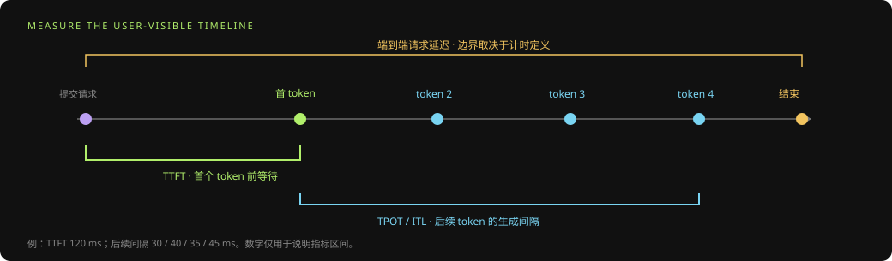
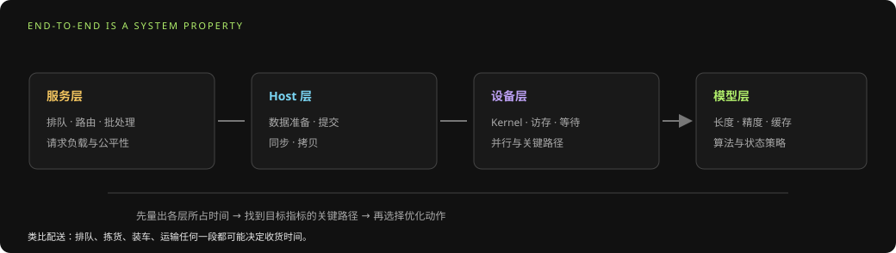

# 模型推理基础：从请求阶段到性能指标

> 面向读者：刚开始承担 LLM 推理、Serving 或性能分析工作的工程师。本文介绍通用概念，并以仓库中的大模型推理规划与洞察为主要依据。

## 摘要

模型推理不是一次孤立的矩阵乘法，而是服务系统对请求进行接收、排队、批处理、模型计算、缓存管理和结果返回的完整过程。分析性能时，要先说明优化目标和测量边界，再区分 Prefill、Decode、服务调度、Host 与设备执行。TTFT、TPOT、吞吐和尾延迟反映不同体验，优化其中一项可能改变其他指标，也可能影响模型质量、资源和稳定性。

## 1. 一次生成请求经历什么

简化后的请求路径如下：

```text
接入/排队 → 请求调度与批处理 → Prefill → Decode 循环 → 返回 token → 完成
                               ↘ KV Cache 读写 ↗
```



- **接入与排队**：认证、路由、排队、限流、请求合并等服务成本。
- **Prefill**：处理输入上下文，计算 prompt 对应的表示，并建立后续生成所需的 KV 状态。常见表现是较大的矩阵计算与输入长度相关成本。
- **Decode**：通常逐步生成 token，每步读取已有上下文状态并产生下一 token；实际批处理、并行和缓存策略取决于推理引擎。
- **返回与结束**：流式发送 token，处理停止条件、取消、超时和后处理。

Prefill/Decode 的具体边界与调度方式会受引擎影响。PD 分离、连续批处理、Prefix Cache、推测解码等是可选设计方向，不应假定所有系统都启用。

> **生活化理解：咖啡店做一杯定制饮品。** 接入和排队像取号；调度决定哪些订单一起制作；Prefill 像店员一次读完备注、准备配料；Decode 像按步骤逐次制作并把饮品状态递交下一步；流式返回则像做好一部分就先递给顾客。这个比喻只帮助理解阶段：真实模型每一步的计算和并发行为仍以推理引擎实现为准。

**小例子：** 用户输入“先解释光合作用，再给一个比喻”。Prefill 处理这段完整 prompt 并形成上下文状态，Decode 再逐个生成后续 token。输入越长，Prefill 工作通常越多；输出越长，Decode 循环通常越多，但请求排队、batch 和缓存状态也会改变实际结果。

## 2. KV Cache 为什么重要

自回归生成会重复使用先前 token 的 Key/Value 中间结果。KV Cache 以额外内存容量换取避免重复计算的机会。其容量与模型层数、KV 头数、每 token 的维度、数据精度、批量与缓存 token 数量等因素相关。

缓存并非免费：它会占用显存/设备内存，影响可承载并发与上下文长度；分页、量化、共享前缀和驱逐策略会改变容量、带宽和管理开销。评估 KV 优化时需同时观察内存占用、吞吐、延迟、命中与质量，而不能只比较单步算子时间。



> **生活化理解：读一本书时做索引卡。** 每读完一段就记下后续查找要用的信息，下一次不用从第一页重新读。KV Cache 保存的是模型计算产生的 Key/Value 状态，不是原文摘要，也不会凭空缩短所有计算；它主要减少重复处理已有上下文的工作，代价是占用内存。

**简化例子：** 假设请求已有 100 个上下文 token，模型随后生成 3 个 token。无缓存的概念性做法可能反复处理越来越长的前缀；有 KV Cache 时，前缀状态可保留，每一步主要处理新 token 并读取已有状态。这里不表示具体引擎的精确算量或耗时，实际收益还受模型结构、缓存布局和带宽影响。

## 3. 常见推理指标

| 指标 | 关注点 | 解读边界 |
|---|---|---|
| TTFT | 请求提交到首个 token 的时间 | 包含哪些排队与网络阶段要明确 |
| TPOT | 生成阶段平均每 token 时间 | 聚合方式和是否剔除首 token需注明 |
| ITL | 相邻输出 token 间隔 | 更贴近流式体验，尾部抖动也重要 |
| 吞吐 | 单位时间处理的请求或 token 数 | 必须写清单位、并发、输入/输出长度 |
| P50/P95/P99 | 延迟分布分位数 | 均值改善不保证尾延迟改善 |
| 显存/内存使用 | 权重、缓存、workspace 等容量 | 需要给出峰值和采样范围 |
| 成功率/错误率 | 服务可用性与任务完成情况 | 性能优化不能以质量或稳定性退化换取 |

不同工具可能用不同计时边界定义同名指标。报告中应记录公式、起止事件、warm-up、样本数和统计方式。



**生活化例子：** 在餐馆里，TTFT 像从下单到第一道菜上桌；TPOT/ITL 像之后每道菜之间等多久；端到端完成时间像最后一道菜上桌。首菜很快、后续很慢，和首菜很慢但上菜稳定，是两种不同体验，因此只报“平均耗时”会丢失重要信息。

**数字演示（仅为算术示例）：** 若首 token 在请求后 120 ms 出现，后面 4 个 token 的相邻间隔为 30、40、35、45 ms，那么 TTFT=120 ms，后续 token 间隔的平均值为 37.5 ms。若这些数字没有把排队、网络和结束事件边界写清楚，它们仍不能与另一套工具的同名指标直接比较。

## 4. 推理性能由多个层次共同决定

```text
服务层：排队、路由、批处理、worker 均衡
Host 层：编排、数据准备、提交、同步与拷贝
设备层：kernel 计算、访存、同步、并行度
模型层：结构、精度、上下文、量化与缓存策略
```

端到端延迟可能由任一层主导。若 Host 或排队占主导，单独优化设备算子可能几乎不改变用户可见延迟；若设备执行占主导，也不能仅凭服务层总耗时判断是哪一个 kernel 或数据依赖造成问题。



> **生活化理解：搬家送货。** 订单排队、调度车辆、仓库拣货、装车和路上运输分别属于不同环节。即使把卡车提速一倍，如果主要时间花在排队或拣货，收货时间也不会减半。对应到推理系统，先定位排队、Host 准备、设备计算或模型策略哪一层处于关键路径，再选择优化对象。

硬件性能可用计算吞吐、内存带宽与算术强度作粗略判断：低算术强度工作可能受访存限制，高计算密度工作可能受矩阵计算能力限制。Roofline 是归因工具，不替代真实 profiling；设备利用率低也可能源于依赖链、粒度、调度或负载不足。

## 5. 建立可靠基线

测试前定义一个 workload manifest：模型与权重版本、输入/输出长度分布、batch/并发、精度、硬件和软件版本、并行策略、缓存状态、随机配置、计时窗口与质量门槛。

基线应满足：

1. 运行环境和输入可追溯。
2. 预热与正式测量分离，重复次数足以估计波动。
3. A/B 测试使用相同请求分布、质量门槛和计时边界。
4. Profiling 采集与正式 wall-clock 测量分开，避免观测开销污染基线。
5. 同时记录服务端到端数据和必要的 Host/Device 分项数据。

若 shape、计时边界、warm-up 或样本口径不同，数字只能视为探索性观察，不能直接报告为优化收益。

**小例子：** 比较两个 Decode Kernel 时，把模型/权重、提示词长度分布、输出长度、并发数、KV Cache 冷热状态、设备和计时范围固定，只改一个 Kernel 版本。否则某一轮恰好缓存命中更多，可能被误认为代码提速。就像比较两条配送路线时，要尽量使用相同的出发时间、货物和交通条件。

## 6. 从症状定位瓶颈

| 观察 | 优先检查方向 |
|---|---|
| TTFT 高而 TPOT 正常 | 排队、长 Prefill、冷启动、编译/加载、首轮缓存 |
| TTFT 正常而 TPOT 高 | Decode 计算/访存、KV Cache 访问、逐步调度开销 |
| 平均值正常而 P99 高 | worker 不均衡、排队尾部、资源竞争、长请求干扰 |
| 设备忙但吞吐低 | batch/并行配置、内存流量、关键 kernel 效率与同步 |
| 设备利用率低且任务等待 | 依赖链、任务粒度、Host 提交间隙、资源分配 |
| 显存不足或并发受限 | 权重、KV Cache、workspace、碎片与缓存策略 |

这些只是诊断入口，不是根因结论。应回到同一次运行的请求、任务与设备证据，验证瓶颈是否位于目标指标的关键路径。

**诊断演练：** 如果 TTFT=800 ms 而后续 token 平均间隔=35 ms，优先把首 token 之前的排队、冷启动、长 Prefill 和首轮准备分开测；不要先优化每步 Decode Kernel。反过来，如果 TTFT 正常而每步都慢，再看 KV 访问、Decode 计算与逐步调度。两个数值仅用于展示推理方法。

## 7. 优化手段与权衡

- **模型/数值**：量化、低精度、结构变化。需评估质量与兼容性。
- **批处理/并行**：增大有效批量、张量/流水/数据并行。可能提高吞吐，也可能增加排队或通信成本。
- **缓存**：Prefix Cache、KV Cache 压缩或复用。需评估容量、命中率、带宽与一致性。
- **算子与编译**：融合、分块、布局、流水、内存复用和同步调整。需用精度与目标 shape 验证。
- **服务调度**：worker 均衡、队列策略、连续批处理、PD 分离等。需以真实流量压测。
- **运行环境**：固定软件栈、预热、常驻权重和减少重复数据准备。

| 手段 | 生活化理解 | 常见收益方向 | 需要同时检查 |
| --- | --- | --- | --- |
| 量化 | 换更轻的行李箱 | 降低权重/缓存体积，可能改善带宽 | 精度与质量门槛 |
| 批处理 | 多单合并配送 | 提高资源利用和吞吐 | 排队时延与请求公平性 |
| Prefix/KV Cache | 重用已经整理好的资料 | 减少重复前缀处理 | 命中率、容量与并发 |
| 算子融合 | 在同一工作台连续完成几步 | 减少中间写回和调度 | 寄存器/内存压力与编译合法性 |
| 服务调度 | 优化派单和路线 | 减少排队和资源不均 | P95/P99 与负载代表性 |

这些类比帮助记忆优化方向，不是因果保证；最终收益要用目标工作负载实测。

每个方案都应写明假设、适用工作负载、预期影响指标、成本和验证方法。

## 8. 推理优化闭环

```text
定义场景与质量红线 → 选择目标指标 → 建立基线 → 定界层次
→ 用证据定位瓶颈 → 提出单一可验证假设 → A/B 验证
→ 检查质量、容量和稳定性 → 灰度/持续监控 → 更新基线
```

优化结果只有在端到端指标和归因证据都支持时才算成立。离线 kernel 提速不能自动推出线上 SLO 改善；线上变化也需排除流量结构和资源配置变化。

## 参考资料

- [大模型推理优化全旅程](../大模型推理优化全旅程.md)
- [单 Rank 模型推理性能数据整理大纲](../单Rank模型推理性能数据整理大纲.md)
- [模型推理相关访谈洞察](../模型推理相关访谈洞察.md)
- [PyPTO 性能调优方法论](../../Insight/PyPTO性能调优方法论_基于Toolkit与案例.md)
- [模型与算子全链路观测主体 Callable 设计](../模型与算子全链路观测主体_Callable设计.md)（产品对象设计参考）

