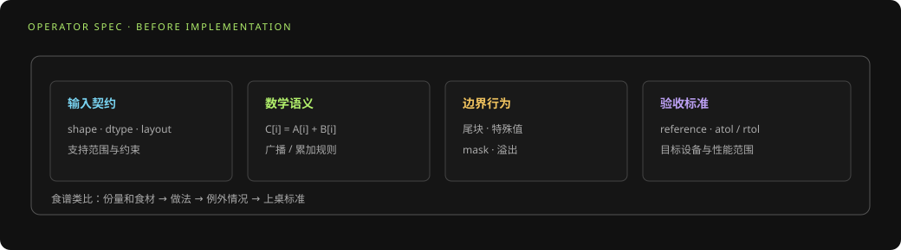
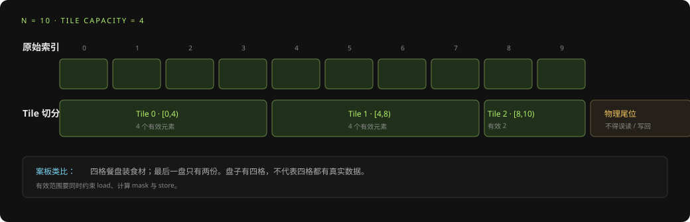
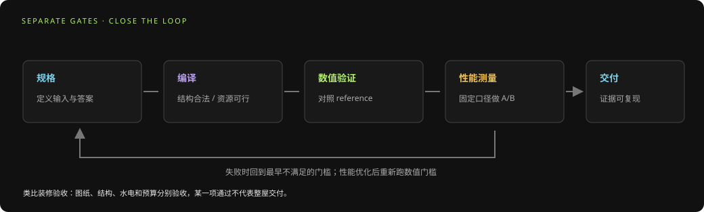

# 算子开发基础：从数学规格到可验证 Kernel

> 面向读者：需要实现、移植或优化 AI 算子的工程师。本文把算子开发组织为一条可复现的工程闭环。

## 摘要

一个算子不仅是一条数学公式，还包含输入输出契约、shape/dtype/layout 约束、边界处理、硬件数据映射、并行和同步、精度要求与性能目标。可靠的开发顺序是先冻结规格，再实现最小正确版本，逐层检查编译与执行，最后基于证据优化。性能优化不能越过正确性门槛，也不能用单个 shape 的收益代表普遍改善。

## 1. 先定义算子规格

在编码前写清：

- 数学定义、输入输出及参数；
- 支持的 shape、动态维与边界条件；
- dtype、累加精度、布局、stride 和对齐要求；
- 广播、mask、padding、舍入与溢出语义；
- 输出允许误差、特殊值行为和确定性要求；
- 目标设备、软件版本、延迟/吞吐/内存目标。

规格是参考实现、测试矩阵和性能结论的共同依据。模糊规格会让“结果不一致”与“实现错误”难以区分。



> **生活化理解：照食谱做菜前先确认菜单。** “做一份炒饭”还不够，至少要知道几人份、米饭是否隔夜、辣度、不能放什么，以及端上桌的标准。算子规格也要讲清输入范围、数学规则、特殊值和误差门槛，否则实现与测试可能各自理解成不同的“正确”。

**小例子：** 向量加法的契约可以写成：输入 A、B shape 相同，长度 N 可变，输出 `C[i] = A[i] + B[i]`，覆盖尾块；输出 dtype 与累加规则明确，使用 reference 对比。若只写“做 Add”，溢出、广播、动态长度和别名规则就仍然悬而未决。

## 2. 将数学表达映射到计算图

先把公式拆为输入、变换、归约、非线性、数据重排与输出等节点，标出依赖和可融合区域。之后再考虑并行切分与数据驻留，不宜从某个 tile 尺寸开始反推算法。

例如矩阵乘法 `C[M,N] = A[M,K] × B[K,N]` 至少要决定：M/N/K 方向如何分块、K 维如何累加、尾块如何处理、A/B 如何复用、输出何时写回。不同 shape 可能需要不同策略。

把公式拆成小步骤，有点像把一份大订单拆成拣货、称重、装箱和出库：每一步要知道输入从哪里来、结果由谁消费。以向量加法为例，图上的 `+` 只表达数学关系，数据搬运、分块和有效区域要由后续步骤补充。

## 3. 设计 Tile 与数据流

Tile 的关键属性包括逻辑/物理 shape、有效 shape、dtype、布局、stride、内存空间和生命周期。典型数据路径包括：

```text
Tensor/DDR → tile.load → 片上缓冲 → move/extract → 计算
            → 累加或转换 → tile.store → 输出 Tensor
```

分块设计要平衡：片上容量、搬运次数、数据复用、并行度、尾块浪费与任务数量。Tile 越大不必然越快：可能减少重复开销，也可能超出容量、压低并发或导致溢出/编译失败。

### 常见片上空间

| 空间 | 常见含义/用途 |
|---|---|
| DDR | 输入输出和大张量的片外存储 |
| Vec / UB | 向量计算或一般 Tile 暂存 |
| Mat / L1 | 矩阵操作数暂存 |
| Left / L0A | 矩阵左操作数 |
| Right / L0B | 矩阵右操作数 |
| Acc / L0C | 矩阵累加结果 |

具体支持的搬运组合和布局受后端约束。编译器可能插入 move 或真实数据搬运；应检查 lowering 后结果。



> **生活化理解：整箱食材分装到小餐盘。** Tensor 像仓库里的整箱，Tile 像厨师一次放到案板上的一小盘。盘子可以按标准尺寸准备，但最后一盘可能装不满；这时“盘子大小”和“真实食材数量”必须分别记录，不能把盘子的空位当成有效数据。

**算一遍：** 若 N=10、每个 Tile 容量 4，起点依次为 0、4、8，三块有效长度是 4、4、2。尾块只应读写索引 8、9。加大 Tile 可能减少分块次数，但也会像案板占满厨房一样，挤掉其他 Tile 的片上空间并压低并行度。

## 4. 并行、流水和同步

SPMD 用逻辑分片扩展并行工作；每个 block 应通过索引映射到互不冲突的数据区域。AIC/AIV 分工、流水 stage、双缓冲与跨核同步可以重叠搬运和计算，但同时增加依赖与资源占用。

设计时检查：

- 数据分片是否覆盖全集且无意外重叠；
- 读写区域是否冲突，边界 mask 是否完整；
- 生产者完成前消费者不会读取未就绪数据；
- buffer 在最后一次使用前不会被覆盖或复用；
- 同步是否必要且粒度适当；
- 增加并行度后是否仍符合资源和容量限制。

> **生活化理解：多人接力装箱。** 一个人拣货、另一个打包、第三个人贴单，只有交接顺序清楚才能并行；如果打包的人拿到的是上一单的物品，速度再快也不正确。流水就是让不同阶段重叠工作，buffer 是每单各自的箱子，同步/依赖则是“这箱拣完了才能封箱”的交接信号。

**小例子：** 三个连续 Tile 的 load、compute、store 若完全串行，可能要等每块三个阶段都做完再开始下一块；流水尝试在计算 Tile 0 时加载 Tile 1。要同时确认输入缓冲没有被下一次 load 覆盖、输出没有提前读取，并且硬件容量能容纳所需 buffer。是否真正重叠，要从编译结果与设备时间线确认。

## 5. 编译与内存规划

编译器可能推导 Tile 内存空间、修正布局、展开 mixed kernel、生成流水与同步、复用 buffer 并分配地址。编译通过只说明编译门槛满足，不证明数值正确、无竞态或性能达标。

出现编译错误时，从最早异常阶段与对应 IR/日志开始，不要只修复最终生成代码症状。出现资源超限时，结合 tile 容量、流水深度、buffer 生命周期和并发配置分析；避免盲目缩小所有 tile。



> **生活化理解：房屋装修的分阶段验收。** 图纸审核通过不代表房间已经建好；结构验收通过也不代表水电功能正确；全部能用之后，还要检查是否达到预算与时间目标。对应到算子，编译、数值、资源和性能是不同关卡，不能用“能编译”替代“算得对”，也不能用“结果正确”替代“达成性能目标”。

## 6. 正确性验证

建立覆盖代表性 shape 和边界的测试矩阵，至少包含：

- 小尺寸、常见尺寸与非整除尾块；
- dtype、布局和动态维边界；
- 全零、极值、随机与必要的特殊值输入；
- 与可信参考实现逐元素或按规范误差比较；
- 多次运行及并发场景（适用时）。

记录 `atol`、`rtol`、比较精度和测试输入。出现数值分歧时，定位首个异常中间量，检查索引、mask、归约顺序、累加精度、数据竞争和内存复用，而不是只调大容差。

**生活化理解：试做一道新菜不能只尝一口。** 要试常见份量、半份和特殊食材；算子测试也应覆盖普通 shape、非整除尾块、极值和特殊值。如果错误只发生在最后两个元素，随机的大输入可能把它淹没。建议把首个错误中间 Tile 和输入一起保存，便于复现。

## 7. 性能分析与优化

先确定测量的是算子、模型子图还是端到端服务；固定设备、版本、shape、dtype、输入和计时范围。再逐级判断：

1. Host 准备/提交是否占主导？
2. 任务依赖是否导致串行或 Core 空闲？
3. 设备执行是计算、访存、同步还是搬运受限？
4. 编译与内存规划是否影响任务粒度或并发？
5. 改动是否缩短目标工作负载的关键路径？

一次只测试一个主要变化，保留基线与候选结果，成对运行并检查离散度。性能结果需附带适用 shape、硬件、软件版本与精度条件。

**小例子：** 一次调优只改变 Tile 长度，先确认同一组输入都通过精度门槛，再比较干净运行的延迟和波动。如果同时改了 Tile、同步和数据布局，即使变快，也很难知道是哪项改变带来的收益；就像一次同时换锅、火力和食材，最后无法复盘真正起作用的因素。

## 8. 常见失误

| 失误 | 后果 | 纠正方法 |
|---|---|---|
| 规格未覆盖尾块和特殊 shape | 只在部分输入上正确 | 先完善约束与测试矩阵 |
| 只看源代码推断内存搬运 | 漏掉编译器插入的 move/extract | 检查关键 IR 与内存分配结果 |
| 假定 logical block 固定绑定物理核 | 错误解读并行和 trace | 区分逻辑分片与实际调度 |
| 仅凭 kernel 平均耗时选热点 | 优化了非关键路径工作 | 结合依赖图和实际关键路径 |
| 解除依赖边追求并行 | 可能产生 race 或错误结果 | 先证明读写不冲突，再做正确性验证 |
| 用 profiling 运行作正式基线 | 观测开销污染计时 | 采集诊断与干净 benchmark 分开 |
| 将单点提速泛化 | 其他 shape/并发可能退化 | 报告收益边界并覆盖代表场景 |

## 9. 推荐交付记录

每个可复现候选至少关联：

- 算子规格与源码版本；
- 目标环境和构建配置；
- 编译结果、资源信息与关键诊断；
- 测试用例、参考输出与精度门槛；
- benchmark 输入、统计方法、原始运行与基线对比；
- 改动假设、适用范围、已知限制和回滚依据。

这样才能让后续工程师或工具从失败证据继续定位，而不必重建全部上下文。

## 参考资料

- [PTO3 写算子过程中的硬件内存感知与配置](../../Insight/PTO3写算子过程中的硬件内存感知与配置.md)
- [PyPTO 性能调优方法论：从证据采集到可复现收益](../../Insight/PyPTO性能调优方法论_基于Toolkit与案例.md)
- [PyPTO3 算子开发可视化基础作业对象](../PyPTO3算子开发可视化基础作业对象.md)
- [人-Agent-Toolkit 协作模式：算子开发流程](../人-Agent-Toolkit协作模式_算子开发流程.md)
- [PTO3 源码、调度与硬件执行概念术语手册](../PTO3_源码_调度_硬件执行概念术语手册.md)

